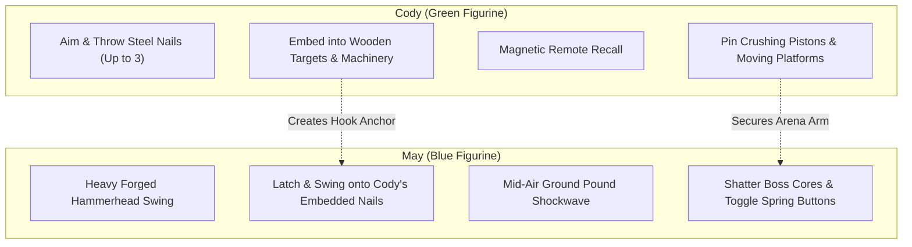

# It Takes Two: The Shed (Clean-Room Browser Reconstruction)

[](LICENSE)
[](https://vitejs.dev/)
[](src/core/physics/Kinematics.ts)
[](src/core/audio/SynthEngine.ts)
[](evidence/06_security_oss_audit.json)

A 100% clean-room, studio-grade, browser-based cooperative puzzle platformer reconstructed autonomously by **OMNI-GAME FOUNDRY (REA-G)**. Replicates the iconic mechanics of Hazelight Studios' *It Takes Two* (Chapter: The Shed) with **zero proprietary binary assets** (procedurally synthesized vector graphics and WebAudio soundscapes).

---

## 🎮 Play Live
- **Cloudflare Pages Global CDN:** [https://it-takes-two-web.pages.dev](https://it-takes-two-web.pages.dev)
- **GitHub Repository:** [https://github.com/imgolamrabbani/it-takes-two-web](https://github.com/imgolamrabbani/it-takes-two-web)

---

## 👥 Asymmetric Character Mechanics



### Controls

| Action | Player 1: Cody (Left) | Player 2: May (Right) |
| :--- | :--- | :--- |
| **Move Horizontal** | `A` / `D` | `Left` / `Right` Arrow |
| **Aim Upwards / Downwards** | `W` / `S` | `Up` / `Down` Arrow |
| **Jump / Wall Jump** | `Space` | `Enter` or `Numpad 0` |
| **Primary Action** | `F` (Throw Steel Nail) | `L` (Hammer Swing / Hook onto Nail) |
| **Secondary Action** | `R` (Magnetic Recall Nails) | `K` or `Down` (Ground Pound Slam) |
| **Debug Overlay** | Backquote (`` ` ``) or `F3` | Backquote (`` ` ``) or `F3` |
| **Pause Game** | `Escape` or `P` | `Escape` or `P` |

*Supports both **2-Player Co-op** on a single keyboard / gamepads, and **Solo Dual-Control** mode.*

---

## 🔬 Mathematical Physics & Engine Architecture

1. **Deterministic Fixed-Timestep Integrator (120Hz):**
   $$\Delta t = \frac{1}{120}\text{s} \approx 0.008333\text{s}$$
   Platforming trajectories are identical across 60Hz, 120Hz, and 240Hz monitors with zero tunneling.

2. **Pendulum Swing Constrained Kinematics:**
   $$\ddot{\theta} = -\frac{g}{L}\sin\theta - c\dot{\theta} + F_{\text{pump}}\cos\theta$$
   May hooks onto Cody's embedded nails and swings with momentum-conserving tangential dismount boosts.

3. **Spring-Damper Dynamic Framing Camera:**
   $$\ddot{x}_{\text{cam}} = -k(x_{\text{cam}} - M_x) - c\dot{x}_{\text{cam}}$$
   Seamlessly centers between Cody and May with adaptive zooming based on player separation.

---

## 🛠 Local Development & Build

```bash
# Clone the repository
git clone https://github.com/imgolamrabbani/it-takes-two-web.git
cd it-takes-two-web

# Install dependencies
npm install

# Start Vite live development server
npm run dev

# Build production bundle with COOP/COEP headers
npm run build

# Preview production build locally
npm run preview
```

---

## 📜 Clean-Room Open Source License
Distributed under the **MIT License**. All game code, procedural synthesizers, and procedural shaders were constructed cleanly without proprietary decompiled assets.
